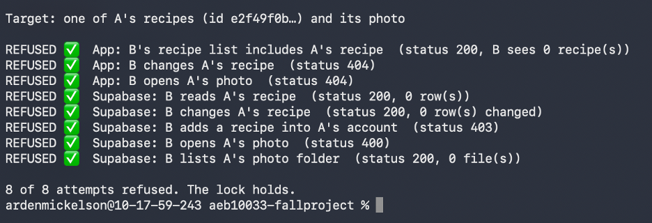

# Security Audit: Scrapbook Kitchen

**Build 3 · Beginner lane · audited November 18, 2026**
**Live app:** https://aeb10033-fallproject.onrender.com
**Hosting:** Render (free web service) · **Database, sign-in, photos:** Supabase (free) · **AI:** OpenRouter

## What needs protecting

| What | Why it matters |
|---|---|
| Each person's recipes, chapters, and photos | Personal. Photos can include family handwriting and kitchens. One account must never see another's. |
| The OpenRouter API key | Anyone who can use it spends my money. |
| The Supabase project | Holds every account's data. |

## How the app is locked

- **Invite-only sign-in.** Public sign-up is turned off in Supabase; I add accounts myself in the dashboard. Sign-in is email + password.
- **Every request needs a sign-in**, except the page itself (which shows the sign-in card) and `/health` (which only says `{"ok":true}`).
- **Sign-in tokens live in cookies** the page's JavaScript can't read (`HttpOnly`), only sent over https on the live site (`Secure`), and not sent with other sites' forms (`SameSite=Lax`).
- **Row Level Security in the database.** Every row in `recipes`, `chapters`, and `ai_reads` has a `user_id`, and Supabase only returns or changes rows where it matches the signed-in person ([`supabase/schema.sql`](supabase/schema.sql)). The server sends each person's own token with every database call, so this lock applies even if the app's code had a bug.
- **Private photo bucket, one folder per account.** A storage rule only allows `photos/<your user id>/…`.
- **No all-powerful key anywhere.** The app never uses Supabase's secret (`service_role`) key; only the publishable key, which is meant to be public.

## What I checked

| # | Check | How | Result |
|---|---|---|---|
| 1 | Secrets never committed | Searched all git history for OpenRouter keys (`sk-or-v1-…`), Supabase secret keys, old-style Supabase keys, PostHog personal keys (`phx_…`), and `service_role`; checked `.env` was never committed and is git-ignored | ✅ 0 matches. Only the PostHog `phc_` project key appears (public by design). |
| 2 | Keys on the live site | Keys are set as Render environment variables, not in code | ✅ |
| 3 | Signed-out requests refused | Called recipes, photos, chapters, and the AI with no sign-in and with a fake sign-in cookie, locally and on the live site | ✅ all 401 "Please sign in." |
| 4 | Public key alone can't reach data | With only the publishable key: read `recipes`, `chapters`, `ai_reads`; add a recipe; list photos | ✅ empty lists; adding refused ("new row violates row-level security") |
| 5 | Nobody can create an account | Tried to sign up a new account with the publishable key | ✅ refused ("Signups not allowed") |
| 6 | **Second account is locked out** | [Lock test](#lock-test-second-account) below, through the live app and directly against Supabase | ✅ 8 of 8 attempts refused |
| 7 | AI spending | Each account gets 30 AI reads per 24 hours (`DAILY_AI_LIMIT`); the model is fixed by the server; asked OpenRouter for the key's own limit | ✅ the key has a **$10 credit limit** (about $0.09 used), so even a leaked key can't spend more |
| 8 | Links can't reach private addresses (SSRF) | Automated tests in [`tests/safe-fetch.test.js`](tests/safe-fetch.test.js); pasted `http://localhost:3000` as a recipe link in the app | ✅ localhost, `127.0.0.1`, `[::1]`, `169.254.169.254`, hex and number tricks, `file://` all refused; the app said "That link points to a private address, so it can't be read." Real recipe sites still load. |
| 9 | Photo paths can't escape the folder | Photo names must be letters, numbers, `-`, `_`, `.`; tried `/images/..%2F..%2F.env` | ✅ refused |
| 10 | Recipe text can't run code on the page (XSS) | Read every place the page inserts HTML | ✅ recipe and AI text goes through `esc()` before it's shown |
| 11 | Upload sizes | Requests over 40 MB, photo downloads over 10 MB, pages over 5 MB are cut off | ✅ |
| 12 | Logs | Server logs never include emails, passwords, tokens, or recipe text from sign-in | ✅ (recipe titles are logged) |

## What I found and fixed

| Found | Risk | Fix |
|---|---|---|
| **No sign-in at all** (Build 2 ran only on my laptop) | On a public URL, anyone could read and change every recipe and spend my AI money | Invite-only Supabase sign-in on every route ([PR #13](https://github.com/building-with-ai-f26/aeb10033-fallproject/pull/13)) |
| **Recipes and photos saved as files on the server** | Render's free plan wipes files on every restart, and files can't be locked per account | Moved recipes and chapters into Supabase with Row Level Security ([PR #14](https://github.com/building-with-ai-f26/aeb10033-fallproject/pull/14)) and photos into a private bucket ([PR #15](https://github.com/building-with-ai-f26/aeb10033-fallproject/pull/15)) |
| **A cached photo showed to the second account.** Found by my own lock test: I copied a photo's address, signed in as the second account, and the photo still loaded | The server and Supabase were refusing correctly, but the browser showed its saved copy. On a shared computer, the next person could see my photos | Photos are cached only for the same sign-in (`Vary: Cookie`), and signing out clears the browser's saved photos (`Clear-Site-Data`). Retested in a private window and after switching accounts: refused ([PR #15](https://github.com/building-with-ai-f26/aeb10033-fallproject/pull/15)) |
| **Reading a link could reach private addresses (SSRF)** | Pasting `http://169.254.169.254/…` or `http://localhost/…` would make the server read its own private network | [`safe-fetch.js`](safe-fetch.js) looks up each link's address and refuses private ones, checking again at every redirect. Used for reading pages and downloading cover photos |
| **A request could choose the AI model** | Someone signed in could ask for the most expensive model on my key | The server always uses the model set in `.env` |
| **No protective headers** | Another site could show the app inside a frame and trick clicks | Added `X-Frame-Options: DENY`, `X-Content-Type-Options: nosniff`, `Referrer-Policy: same-origin` |
| **The OpenRouter key would have been usable by anyone** | Before sign-in, a public URL meant anyone could run AI reads | Sign-in plus the per-account daily limit |

## What is left (known risks I'm accepting for now)

- **Sign-in attempts are only limited by Supabase's built-in rate limits.** There's no lockout after many wrong passwords. Accounts are invite-only, which lowers the risk.
- **No CSRF token.** The app relies on `SameSite=Lax` cookies and JSON request bodies, which stop other websites' forms from making changes. Good enough for this app; a token would be stronger.
- **No Content-Security-Policy.** The page uses inline scripts and PostHog's loader, so a strict policy needs more work.
- **SSRF check has a small timing gap (DNS rebinding).** The address is checked, then fetched; a hostile website could change its address between the two. Hard to pull off, and the server holds no private services besides itself.
- **The daily AI limit is per account, not for the whole app.** With 2 accounts the worst case is about 60 reads a day (≈ $0.12), and the OpenRouter key's $10 credit limit caps the total either way.
- **Backups.** Supabase's free plan has no point-in-time restore. My pre-Supabase data is still on my laptop in `data/`. A regular export is a Build 5 task.
- **Free-plan pauses.** Render sleeps after ~15 minutes idle (the first visit takes 30–60 seconds), and Supabase pauses a free project after about a week with no activity.
- **Error messages can include Supabase's error text** (for example "Database error (400): …"). They don't contain keys or other people's data.
- **Editing the same recipe in two tabs at the same moment**: the last save wins.

## Lock test (second account)

**Setup:** two real accounts. A is mine (24+ recipes with photos). B is a second, invited test account with no recipes.

**How to run:** `node tests/lock-check.js` ([script](tests/lock-check.js)). It signs in as A to pick one recipe and one photo, then signs in as B and tries to read, change, and open them, through the live app and directly against Supabase with B's own sign-in. It changes nothing while the locks hold.

**Results (November 18, 2026):**

**8 of 8 attempts refused. The lock holds.**

| Account B tries to… | Through | Result |
|---|---|---|
| See A's recipe in its recipe list | Live app | ✅ Refused: B sees 0 recipes |
| Change A's recipe | Live app | ✅ Refused: 404 Not found |
| Open A's photo | Live app | ✅ Refused: 404 Not found |
| Read A's recipe | Supabase directly | ✅ Refused: 0 rows |
| Change A's recipe | Supabase directly | ✅ Refused: 0 rows changed |
| Add a recipe into A's account | Supabase directly | ✅ Refused: 403 |
| Open A's photo | Supabase Storage directly | ✅ Refused: 400 |
| List A's photo folder | Supabase Storage directly | ✅ Refused: 0 files |

The direct Supabase attempts skip my app entirely, so they show the database's own lock rules hold even if my server code had a bug.

**Earlier manual checks (November 18, 2026):**
- Signed in as B in the browser: the board shows **0 recipes**.
- Opened one of A's photo addresses while signed in as B: `{"error":"Not found"}`. (The first try showed a cached copy; fixed as described above.)

